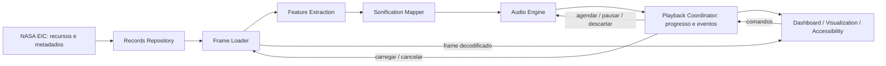

# Arquitetura

## Camada visual georreferenciada — 15/11/2026

O renderer Canvas2D existente consulta um raster próprio NASA Black Marble 2012 em sua inversa ortográfica por pixel. `night-lights.mjs` verifica/decode uma única imagem local e fornece consulta bilinear EPSG:4326/PixelIsArea; `GlobeRenderer` reutiliza buffer/LUT e compõe âmbar com intensidade limitada. O módulo nativo guarda somente estado dessa camada visual, com cache único/toggle/status/abort/fallback. Seu ano é fixo em 2012 e não segue o seletor do áudio. Nenhuma latitude/longitude passa a gerar notas. PNGs e pipeline sonoros permanecem separados e inalterados.

Tokens tipográficos compartilhados em `src/styles.css`, fonte do sistema e controles maiores preservam a composição única. O foco do painel agora usa `afterNextRender` cancelável para aguardar o DOM expandido. Fonte, transformação, orçamento de buffers, desempenho e consequências em [night-lights-globe-delivery](night-lights-globe-delivery.md). Trata-se de evolução da apresentação dentro das fronteiras existentes; não há novo backend, contexto de áudio, biblioteca ou alteração dos contratos de sonificação.

[Índice](README.md) · [Contratos](contracts.md) · [Roadmap](roadmap.md) · [Decisão de escopo](decisions/0001-mvp-scope.md)

## Composição de tela única — 15/11/2026

Implementação local em **`feat/single-screen-observatory`**, base **`2c424b0474c7c96589d02d3db5e21a922aee258c`**. A autorização atual reúne as experiências existentes. A [decisão científica](single-screen-science.md) recomenda a estratégia B antes da integração: preservar a varredura 2D NASA e comunicar explicitamente a independência da seleção geográfica. Isso mantém as fronteiras e a prioridade científica da [ADR 0001](decisions/0001-mvp-scope.md), sem mudar contratos, fonte ou algoritmos.

`App → Index` fornece um único PlaybackCoordinator e compõe uma área principal com cabeçalho, PlanetEarth e AudioPanel. O Index mantém apenas estado de apresentação (`scienceOpen` e breakpoint compacto), recebe os pontos geográficos do wrapper e envia-os ao coordenador pelo contrato existente. O `GlobeModel` mantém exploração, seleção, destinos e zoom. Não há estado de áudio novo em `observatory.mjs`.

O AudioPanel foi reaproveitado em duas regiões da mesma composição: painel científico contextual e player na base. Ele continua montado ao recolher a ciência; imagem, loading/erro, leitura e comandos consomem os signals do coordenador existente. Play revela o painel e envia o comando de reprodução. “Listen to Earth” abre/focaliza a ciência, e “About & credits” abre o método; esses comandos não iniciam áudio. Os dados podem ser preparados no navegador sem criar um AudioContext antes de Play.

Em telas a partir de 1000 CSS px, a ciência fica na lateral com o planeta em destaque. Abaixo disso, abre em drawer dentro do observatório e preserva o player acessível. Close/Escape restauram foco ao CTA; o planeta fica `inert` enquanto o drawer compacto está aberto. `matchMedia` só é acessado no browser e seu listener é removido por DestroyRef. O foco adiado do painel usa requestAnimationFrame cancelado ao recolher/destruir. Painéis permitem rolagem interna; telas baixas e reflow podem crescer sem impor corte absoluto em 100vh. A fronteira SSR e o teardown do globo/coordenador permanecem existentes.

O percurso de dados continua `catálogo → FrameLoader → extração/mapa → WebAudioEngine`, coordenado pelo PlaybackCoordinator. O marcador NASA deriva da extensão da feature aceita e seu destaque de execução usa o feedback real do evento. Nenhuma latitude/longitude é convertida em pixel científico. Não há segundo motor, contexto, pipeline, backend ou dependência.

Foram alterados composição Angular, templates/CSS e DOM de apresentação do observatório, com testes correspondentes. Nenhum componente foi removido; Dashboard permanece desmontado e somente seu spec foi compatibilizado com os nomes pt-BR já presentes na base. Motor, loader, catálogo, assets/hashes/máscaras, núcleo do renderer e configurações de build/Firebase permanecem. A saída estática e os caminhos públicos do Firebase Hosting são preservados; não houve deploy. A validação final passou em build/SSR, 78 testes Angular, oito Node, smoke de produção e smoke de navegador com contexto/osciladores reais. Resultados, artefatos e limites humanos em [single-screen-delivery](single-screen-delivery.md).

## Implementação presente — 15/11/2026

Na árvore `feat/f3-sonification` sobre `64659fba`, App → Index monta AudioPanel e o Observatório Âmbar já integrado pela brain. O Index fornece um PlaybackCoordinator para a experiência e recebe pointSelected do wrapper. Os módulos nativos do globo foram preservados; o Dashboard legado não está montado. Fonte local curada → FrameLoader → funções puras de extração/mapa → WebAudioEngine; o coordenador publica signals consumidos pelo painel, com revisão para descarte de resultados/callbacks. Detalhes e evidências em [entrega de sonificação](sonification-delivery.md).

Construtores não acessam APIs browser; o painel carrega somente no navegador, o motor cria/retoma contexto somente em Play e o servidor renderiza explicações/controles inativos. O boot existente já não utiliza Firebase/environments locais e passa SSR; essa correção veio com o mundo, sem remoção de dependências nesta sessão. Não há adaptador lat/lon→pixel, calibração física ou backend novo.

## Estado na auditoria F0 — histórico

A aplicação usa componentes Angular standalone: `AppComponent` renderiza `IndexComponent`, que reúne `DashboardComponent` e `PlanetEarthComponent`. As seis páginas do painel são seções do Dashboard, sem rotas próprias; `app.routes.ts` contém uma lista vazia. Referências: [App](../../src/app/app.component.ts), [Index](../../src/app/view/index/index.component.html) e [rotas](../../src/app/app.routes.ts).

O Dashboard concentra catálogo demonstrativo, navegação, parâmetros musicais, cursor, preferências e compartilhamento. Os métodos de integração de catálogo, frames, áudio e globo são vazios em [dashboard.component.ts](../../src/app/view/screen-components/dashboard/dashboard.component.ts), na seção `INTEGRATION`. Não há pipeline científico, relógio de reprodução ou comunicação de dados com PlanetEarth. O template de [PlanetEarth](../../src/app/view/screen-components/planet-earth/planet-earth.component.html) contém apenas o texto de criação do componente. Consulte a evidência detalhada em [current-state.md](current-state.md).

AngularFire/Auth e SSR estão configurados, mas não constituem requisitos já comprovados do produto. O build auditado gerou bundles e terminou com código zero, porém registrou `ReferenceError: window is not defined` ao executar `readSettingsFromUrl` no servidor. Portanto, SSR/prerender ainda não passa no gate; tratar em **F1-03**. Não remover ou ampliar Firebase/SSR nesta F0.

## Arquitetura-alvo da F0 — referência de evolução

Esta seção preserva a proposta histórica; nenhum módulo descrito foi implementado pela F0. A fatia atual aplica essas fronteiras conforme o registro acima; funcionalidades e gates fora dela continuam futuros. Um backend próprio e um globo 3D não são dependências do primeiro MVP.

O fluxo de referência acompanha dados até o feedback da reprodução. O Coordinator também orquestra carregamento e áudio; não é uma etapa que transforma áudio novamente. O estado de domínio e os contratos unem os módulos; referências de DOM, `AudioNode` e imagens decodificadas ficam nos adaptadores que controlam seus ciclos de vida.

| Responsabilidade | Entrada e saída | Limite e integração futura |
|---|---|---|
| Records Repository | Manifesto validado → `ScientificRecord` | Catálogo, proveniência, condições de uso, legendas e limitações. Pode começar com manifesto local; não inventar endpoints a partir dos comentários do Dashboard. **F2-02**. |
| Frame Loader | Registro + identificador de frame → recurso decodificado e metadados | Carregamento, erros, cancelamento, cache limitado e liberação de recursos. Não interpreta cores como grandezas físicas. **F2-03**. |
| Feature Extraction | Frame + estratégia/máscaras → `ExtractedFeature` | Amostragem reproduzível, exclusão de regiões sem dados e declaração de domínio pixel/medida. **F3-01**. |
| Sonification Mapper | Features + configuração versionada → `SonificationEvent` | Normalização, quantização e regras musicais explícitas. Não inicia áudio nem altera a fonte científica. **F3-01**. |
| Audio Engine | Eventos + comandos de volume/reprodução → áudio e feedback de execução | Web Audio API como primeira opção; criação no navegador após gesto do usuário, envelope, ganho e limites de vozes. **F3-02/F3-03**. |
| Playback Coordinator | Comandos + resultados assíncronos → `PlaybackState` | Fonte única de seleção, posição, modo, carregamento, erro e transporte; coordena o relógio do áudio. **F4-01/F4-02**. |
| Visualization Adapter | Frame aceito + posição de exploração → imagem e marcador | Exibição 2D primeiro; globo apenas quando houver transformação espacial verificável e benefício demonstrado. |
| Accessibility | Estado e explicação do mapeamento → controles e alternativa textual | Semântica, teclado, foco, mensagens de erro e anúncios limitados. A informação científica básica deve existir sem ouvir ou enxergar. **F5-01/F5-02**. |

Essas são fronteiras lógicas. Não criar automaticamente um serviço por linha. O Coordinator pode inicialmente compor módulos pequenos; separar extração/mapeamento como funções puras quando isso facilitar validação. O Dashboard deve consumir estado e enviar intenções, em vez de manter cópias independentes de `playing`, frame e configurações em cada controle.

## Fluxo de seleção e carregamento

1. Validar o manifesto, selecionar o registro e resolver o frame por identificador estável, sem presumir que seu índice representa um ano.
2. Ao trocar de registro/frame, incrementar uma revisão da sessão, pausar a emissão anterior e cancelar o carregamento anterior quando suportado.
3. O Loader entrega recurso, revisão e metadados. O Coordinator descarta respostas de revisões antigas, inclusive quando o transporte não permite cancelamento.
4. Decodificar e verificar dimensões, procedência, legenda, máscaras e compatibilidade com a estratégia de extração. Erro não pode virar dado zero.
5. Calcular features e eventos com as versões declaradas. Só publicar estado `ready` quando imagem, features e metadados pertencem ao mesmo frame aceito.
6. O usuário inicia a reprodução explicitamente. Trocar de registro não inicia áudio automaticamente; a política de retomada após seek deve ser explícita e testada.

Um frame tem tempo de apresentação e pode ter um período de observação diferente. Uma comparação entre 2012 e 2023 não comprova a existência de doze frames anuais. A seleção do manifesto depende da inspeção dos recursos em **F2-02**, especialmente para [Change in Night Lights](data-and-sources.md).

## Fluxo de áudio e sincronização

- O Audio Engine possui um único `AudioContext` ativo por experiência. Criar/resumir a partir de gesto do usuário e verificar seu estado real antes de anunciar reprodução.
- Usar o relógio do áudio (`AudioContext.currentTime`) para agendamento. A posição visual acompanha o evento/posição confirmados pelo Coordinator; `requestAnimationFrame` pode desenhar o cursor, sem se tornar o relógio científico ou sonoro.
- Agendar uma janela curta de eventos, com horizonte e quantidade de vozes limitados. Os valores serão escolhidos e medidos na implementação; não há orçamento aprovado nesta F0.
- Pause deve cancelar eventos futuros e encerrar ou silenciar suavemente as vozes ativas, preservando a posição lógica. Resume cria uma nova referência de tempo para essa posição, sem reproduzir eventos antigos acumulados.
- Seek, troca de registro/modo e nova sessão invalidam a fila anterior. Mudanças de velocidade recalculam os eventos ainda não executados; volume/mute alteram o ganho de saída e o estado textual correspondente.
- Ao destruir a experiência, interromper fontes, desconectar nós, remover callbacks e liberar contexto/recursos. Erro ou suspensão pelo navegador deve atualizar `PlaybackState`, sem deixar o botão anunciar áudio ativo.
- O feedback identifica registro, frame, feature e versão do mapeamento. Barras decorativas não servem de prova de áudio ou sincronização; um visualizador real deve receber análise do sinal.

Começar com Sweep determinístico e poucos parâmetros. Explore exige uma posição válida na imagem; latitude/longitude só pode ser utilizada quando a projeção e a transformação para pixels forem conhecidas. Correntes oceânicas são uma segunda candidata, opcional; não ampliar o pipeline antes de validar a primeira visualização.

Referência técnica consultada: [Web Audio API 1.0 — W3C Recommendation](https://www.w3.org/TR/webaudio-1.0/). O desenho de scheduling e ciclo de vida acima é uma proposta de engenharia a validar em F3/F4.

## Fidelidade científica e fallback

Brilho, RGB e posição são características da representação visual. Sem calibração verificada, não equivalem a temperatura, concentração, velocidade de corrente ou outra unidade física. A interface deve explicar “brilho relativo da imagem”, por exemplo, quando esse for o domínio real. Máscaras devem excluir texto, molduras, legendas, fundo e ausência de dados conforme o recurso; registrar o que não foi possível excluir. Ver [contracts.md](contracts.md).

Validar leitura de pixels no navegador de destino. Um recurso que aparece em `` pode bloquear extração em canvas por CORS. A estratégia é testar a origem, usar recursos locais legitimamente obtidos quando permitido e manter créditos/versão/proveniência. Não contornar a política do navegador com proxies arbitrários, nem tratar download ainda não realizado como fallback existente.

O fallback planejado deve ser o mesmo recurso científico validado, acompanhado de manifesto e condições de uso. Se remoto e local falharem, mostrar erro compreensível e alternativa textual disponível; não substituir por dados sintéticos nem som de fundo. A existência, tamanho e permissão de distribuição do pacote local precisam ser comprovados em F2.

## Angular e SSR

Manter os componentes standalone. A organização futura pode agrupar domínio, processamento e adaptadores sob `src/app`, sem mover arquivos nesta tarefa. Não criar rota ou biblioteca apenas para atender ao diagrama. Os hooks vazios atuais são pontos de integração a substituir gradualmente, preservando controles úteis.

APIs como `window`, `navigator`, `localStorage`, canvas, Web Audio e observadores de layout só podem ser utilizadas em execução de navegador verificada. Provedores/adaptadores devem ter inicialização tardia; SSR pode renderizar catálogo, descrições e controles em estado inativo, sem iniciar contexto de áudio nem ler pixels. Evitar efeitos no topo do módulo e nos construtores. A guarda deve envolver o acesso inteiro, inclusive leitura da URL em `ngOnInit`, e não apenas capturar falhas de storage.

Validar renderização no servidor, hidratação e navegação no navegador. Uma compilação com código zero não aprova SSR quando o log contém erro de execução. A escolha de manter ou simplificar SSR/Firebase requer análise em F1 e ADR se alterar a arquitetura de entrega; não está decidida nesta documentação.

## Desempenho e validação

Processar apenas a resolução necessária, com estratégia de amostragem registrada. Reutilizar resultados por recurso + estratégia + versão; limitar cache e liberar imagens/URLs temporárias. Não decodificar todos os frames antecipadamente. Medir tempo de carregamento/extração, memória, continuidade sonora e resposta a pause/seek nos dispositivos-alvo antes de adotar worker, GPU ou biblioteca adicional.

Validar extração/mapeamento com entradas controladas e resultados esperados; validar áudio por execução real e inspeção de eventos; validar integração mostrando frame e evento de mesma origem. Fixtures artificiais podem testar algoritmos quando identificadas como testes e separadas do catálogo científico. Evidências e limites de aprovação estão em [quality-gates.md](quality-gates.md).
